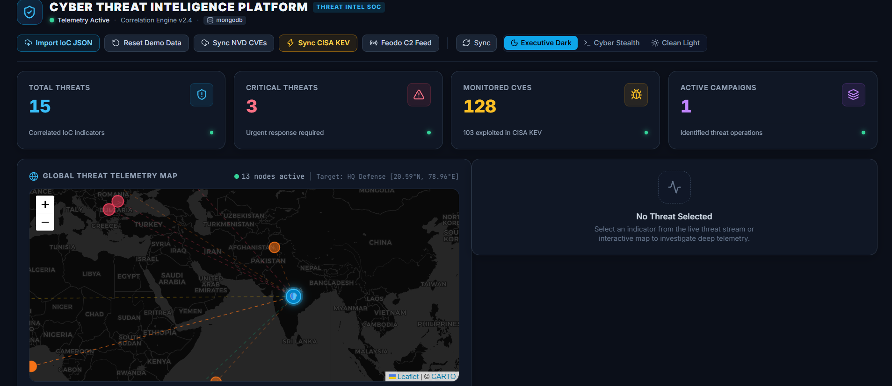

# AI-Powered Cyber Threat Intelligence and Risk Prioritization Platform

**OPCODE IMPACT 2026 | Hackathon Submission**

**Team ID:** OPC035

## 1. Problem Statement
Organizations struggle to analyze the growing volume of cyber threat data from vulnerabilities, malicious IPs, and attack intelligence. Fragmented information and excessive alerts delay threat detection and response, increasing the risk of cyberattacks and data breaches.

## 2. Solution Title
AI-Powered Cyber Threat Intelligence and Risk Prioritization Platform

## 3. Solution Description
Our solution is an AI-powered Cyber Threat Intelligence Platform that collects and correlates data from CVE databases, threat intelligence feeds, and MITRE ATT&CK. It identifies relationships between malicious IPs, vulnerabilities, malware, and attack techniques to detect potential threats. The platform assigns risk scores to prioritize critical threats and uses AI to explain threats and recommend defensive actions. A centralized dashboard visualizes threat intelligence and attack chains, helping security teams detect, analyze, and respond to cyber threats faster.

## 4. Architecture Diagram


Data Collection: Gather CVEs, malicious IPs/domains, threat intelligence feeds, and MITRE ATT&CK data.

Data Processing: Normalize and organize the collected information.

Threat Correlation: Identify relationships between vulnerabilities, malware, indicators, and attack techniques.

Risk Assessment: Calculate risk scores to prioritize critical threats.

AI Analysis & Dashboard: Explain detected threats, recommend defensive actions, and display results on a centralized dashboard.

## 5. Technology Stack
- **Frontend:** [React.js, Tailwind CSS, Recharts]
- **Backend:** [Python, FastAPI]
- **Database:** [MongoDB]
- **Other Technologies:** [AI/LLM (Ollama + Llama), NVD/CVE API, CISA KEV Catalog, MITRE ATT&CK, public threat intelligence feeds, Git/GitHub]

## 6. Quick Start Guide
**Prerequisites:** 
Python 3.10+ and pip

Node.js 18+ and npm

MongoDB (local installation or MongoDB Atlas)

Git and GitHub

Code editor (VS Code recommended)

Internet connection to access NVD/CVE APIs and public threat intelligence feeds

Ollama with a compatible Llama model (optional, for AI-powered threat analysis)

**Installation & Execution:**
```bash
# Add commands to install dependencies
for frontend
npm install
for backend 
pip install -r requirements.txt
# and run your project here
for backend
uvicorn main:app --reload --port 8000

for frontend
npm run dev

```

## 7. Output Screenshots


The dashboard of a Cyber Threat Intelligence Platform  for tracking security threats, vulnerabilities of CVE, and campaigns. There is an interactive map called Global Threat Telemetry Map with 13 live threat nodes attacking the “HQ Defense” node.

## 8. Future Scope
- Real-time threat detection: Combine live threat intelligence sources and automated monitoring for faster detection of emerging threats.
- Predictive AI Analytics: Employ machine learning to detect future attack vectors, suspicious activities, and prioritize threats.

## 9. Team Contributions
| Member Name | Contribution |
|-------------|--------------|
| Akshay N | [developing  ui/ux (part 1)] |
| [Abhinav KR] | [Integration of local llm(ollama)] |
| [Colin Philip] | [corelation engine design (partial completed)] |
| [Adhil Rahman PP] | [Data Collection (Part 1st completed)] |

## 10. Tools Used
| Tool / Platform | Purpose / Why Used |
|-----------------|--------------------|
| [VS Code] | [Used as the main code editor to develop and manage the frontend and backend code.] |
| [Antigravity] | [Used as an AI-assisted development environment to help generate, modify, and debug code.] |
| [Claude] | [Used as an AI assistant for coding support, problem-solving, and improving project implementation.] |
| [Postman] | [Used to test backend APIs, send HTTP requests, and verify API responses.] |
| [PowerShell] | [Used to run development commands, manage dependencies, and start the frontend and backend serv] |